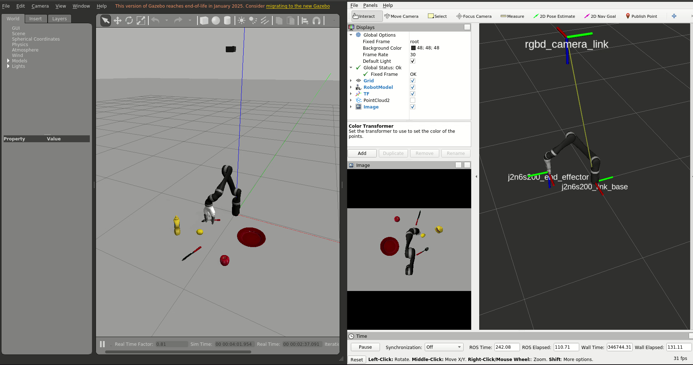

# ROS Kinova Docker

## Building the image

- Run the following command in a terminal
  `./build.sh`

- To force rebuilding the image use the option `-r`

## Running the container

- Launch the server by running the following command in a terminal
  `./server.sh`

- Launch as many client as you need by running the following command in a terminal
  `./client.sh`

- The folders `ros`, `workspace` and `share` are automatically mounted in the container, respectively as `/home/os/.ros`, `/home/ros/ros_ws` and `/home/ros/share`
  This allows editing the workspace and looking through the logs from the development computer. Any file or folder copied to any of these folders will be accessible both from the container and the development computer.

- Build the sources
  `catkin_make`

## Working with Kinova in simulation

- Execute the following commands inside the container
  `source devel/setup.bash`
   `roslaunch robot_cuisto start_simulation.launch`
This will launch the simulated Kinova in Gazebo and an instance of Rviz. 
The script will also automatically position the arm above the "table", where several kitchen objects are placed.
An RGB-D camera is also fixed above the scene, pointing downward. The images, depth and point clouds can be visualized in Rviz.

In the sources, you can find 2 scripts:

 - `~/ros_ws/src/robot_cuisto/scripts/go_to_initial_config.py` -> this script is called by the start launch file to position the arm in its initial configuration. It is a good example of how to control the arm directly using joint positions.
 
 - `~/ros_ws/src/robot_cuisto/scripts/go_to_gripper_pose.py` -> this script provides an example of how to control the arm by sending a target gripper pose, expressed with respect to the arm base.
 You can run this script with :
   `rosrun robot_cuisto go_to_gripper_pose.py /joint_states:=/j2n6s200/joint_states`

